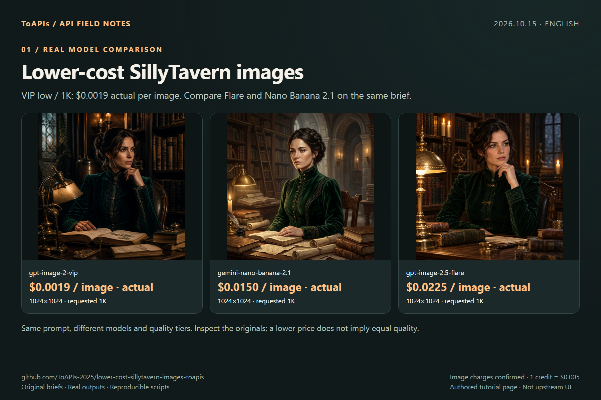

# Lower-cost SillyTavern ToAPIs images

<!-- TOAPIS-MODEL-COST-UPDATE-20261016 -->
## Tested model types, presets and costs

Updated October 16, 2026. These are tested historical presets/prices; this addition does not relabel the original batch below.

| Model (API ID) | Type | Tested preset | Unit quote | Confirmed unit charge | Count |
|---|---|---|---:|---:|---:|
| gpt-image-2(VIP) (`gpt-image-2-vip`) | Image | low / 1K / n=1 | $0.0019/image | $0.0019 | 1 |
| gpt-image-2.5-flare | Image | high / 1K / n=1 | $0.0225/image | $0.0225 | 1 |
| Nano Banana 2.1 (`gemini-nano-banana-2.1`) | Image | 1K / n=1 | $0.015/image | $0.015 | 1 |
| doubao-seedream-5-0-pro-global | Image | 1K | $0.045/image | $0.045 | 1 |

Confirmed original image/video example subtotal: **$0.0844**.

Optional server-side image handler validated; chat UI, NSFW and video remain unvalidated. Historical video submission returned HTTP 400.

gpt-image-2(VIP), **from $0.0019/image**; the tested low/1K preset here is **$0.0019/image**. Different models, qualities and resolutions do not imply equivalent results.
<!-- /TOAPIS-MODEL-COST-UPDATE-20261016 -->

[中文](README_zh-CN.md) · [Original README](README.upstream.md)

[ToAPIs · model pricing & API](https://go2v.toapis.com/ta15ge)

**2026-10-15: 4 real outputs; actual image charges $0.0844 (16.88 credits), confirmed from the backend screenshot.**

The opt-in server-side image handler produced OpenAI-style image responses. Fully clothed adult-character images only. The running chat UI and NSFW generation were not validated.

## Demo



### Seedream global: non-explicit adult character



`doubao-seedream-5-0-pro-global`: requested 1K, actual 2048×2048. Owner-provided pricing: 1K $0.045, 2K $0.09. This run was charged 9 credits = $0.045. NSFW capability was not validated.

## Prices for the tested models

| Model | Requested preset | Actual pixels | Quote / request | Actual charge |
|---|---|---|---:|---|
| [`gpt-image-2-vip`](https://go2v.toapis.com/ta15v) | low / 1K | 1024×1024 | $0.0019 | $0.0019 / 0.38 credits |
| [`doubao-seedream-5-0-pro-global`](https://x.toapis.com/ta15g) | 1K | 2048×2048 | $0.0450 | $0.0450 / 9 credits |
| [`gemini-nano-banana-2.1`](https://x.toapis.com/ta15n) | 1K | 1024×1024 | $0.0150 | $0.0150 / 3 credits |
| [`gpt-image-2.5-flare`](https://im25.toapis.com/ta15f) | high / 1K | 1024×1024 | $0.0225 | $0.0225 / 4.5 credits |

Actual image total: **$0.0844**. Image charges were confirmed from the backend screenshot; 1 credit = $0.005. Global uses owner-provided pricing; other quotes use the live `/v1/pricing` catalog. Different models and quality tiers do not imply equal quality.

## Reproduce

Python 3.11+; Node 22+ for Node/TS native-entry checks.

```bash
python -m pip install Pillow
python generate_case.py --model gpt-image-2-vip --prompt "An original product photograph, no text"
# Dry-run: no network call. Set TOAPIS_API_KEY privately before --live.
python generate_case.py --model gpt-image-2-vip --prompt "An original product photograph, no text" --run-id my-unique-case --output result.png --live
```

`TOAPIS_BASE_URL=https://toapis.com` or `https://toapis.cn`; `/v1` is appended once. `TOAPIS_STATE_DIR` stores private durable task state. `TOAPIS_MAX_IMAGE_USD` defaults to 0.10. Never commit the key or private state.

### Native entry and scope

`src/endpoints/openai.js` dispatches only when `request.body.toapis === true`; `src/endpoints/toapis-images.mjs` keeps the key server-side and returns `data[0].b64_json`.

`node smoke_native.mjs < case.json`. This tests the actual new handler with request/response objects; it does not start or validate the full SillyTavern server/UI. Existing OpenAI behavior remains selected unless the explicit flag is supplied.

MiniMax-H3-global 5s / 768p video contract probe: quote $0.40, HTTP 400, no task ID or playable result. Not a validated provider; no automatic retry.

### API mapping

`POST /v1/images/generations` → persist returned task ID → `GET /v1/images/generations/{id}` → download result without forwarding the API key to the CDN. Bearer authentication is used only for the API origin. No automatic POST retries. Uncertain submissions remain blocked until reconciled.

The adapter maps explicit pixel hints to aspect ratio and sends model-specific resolution fields. JPEG responses are preserved as original JPEG and separately converted to PNG for display; real pixel sizes are recorded. A requested 1K tier is not a guarantee of exactly 1024×1024 pixels.

## Evidence and screenshot walkthrough

- [Per-task records](evidence/)
- [Original outputs](examples/)
- [Model comparison](screenshots/en/01-models.png)
- [API steps](screenshots/en/02-api.png)
- [Reuse and limits](screenshots/en/03-reuse.png)

Upstream: [SillyTavern/SillyTavern](https://github.com/SillyTavern/SillyTavern/tree/06bde939fb1e9c4c8d8641d810f0a916b5bce127), pinned `06bde939fb1e9c4c8d8641d810f0a916b5bce127`. Community work; no author endorsement or existing partnership is implied. [Attribution](NOTICE.md).

[Dashboard-confirmed itemized image charges](evidence/actual-charges.json). Video submissions without task IDs are excluded and remain unreconciled.
