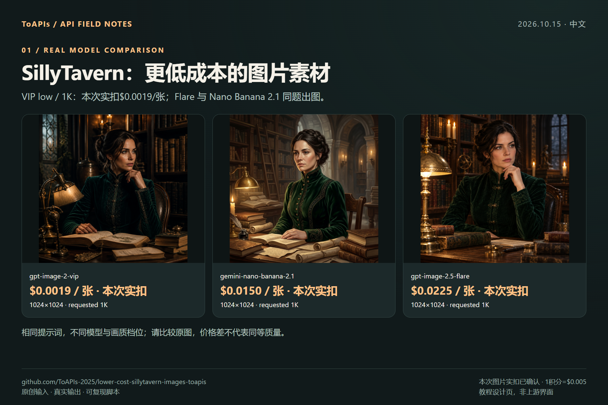

# 更低成本的 SillyTavern 角色图片方案

[English](README.md) · [上游说明](README.upstream.md)

[ToAPIs · 对应模型价格与接入](https://go2v.toapis.com/ta15gc)

**2026-10-15：4 张真实输出，图片实扣合计 $0.0844（16.88积分），后台截图已确认。**

成人角色生态的非露骨素材：新增ToAPIs服务端处理器 → 现有图片响应形态；完整聊天UI未验收。

## 演示



### Seedream global：非露骨成年角色


`doubao-seedream-5-0-pro-global`：请求 1K，实际 2048×2048。用户价表报价 1K $0.045、2K $0.09；本次实扣9积分=$0.045。没有验证 NSFW 能力。

## 本次对应模型价格

| Model | Requested preset | Actual pixels | Quote / request | Actual charge |
|---|---|---|---:|---|
| [`gpt-image-2-vip`](https://go2v.toapis.com/ta15v) | low / 1K | 1024×1024 | $0.0019 | $0.0019 / 0.38 credits |
| [`doubao-seedream-5-0-pro-global`](https://x.toapis.com/ta15g) | 1K | 2048×2048 | $0.0450 | $0.0450 / 9 credits |
| [`gemini-nano-banana-2.1`](https://x.toapis.com/ta15n) | 1K | 1024×1024 | $0.0150 | $0.0150 / 3 credits |
| [`gpt-image-2.5-flare`](https://im25.toapis.com/ta15f) | high / 1K | 1024×1024 | $0.0225 | $0.0225 / 4.5 credits |

本次图片实扣合计： **$0.0844**. 本次图片实扣已由后台截图确认；1积分=$0.005。除 global 为用户提供价表，其余为当天实时 `/v1/pricing`。不同模型/画质不是等效质量比较。

## 复现

环境：Python 3.11及以上；Node/TS原生入口验收另需Node 22及以上。

```bash
python -m pip install Pillow
python generate_case.py --model gpt-image-2-vip --prompt "An original product photograph, no text"
# 默认演练不联网。实测前在本机私下配置 TOAPIS_API_KEY，再显式加 --live。
python generate_case.py --model gpt-image-2-vip --prompt "An original product photograph, no text" --run-id my-unique-case --output result.png --live
```

`TOAPIS_BASE_URL`可填`https://toapis.com`或`https://toapis.cn`，只补一次`/v1`。`TOAPIS_STATE_DIR`保存本地私有任务状态；`TOAPIS_MAX_IMAGE_USD`默认单图报价上限为0.10。不要提交Key或私有状态目录。

### 原生入口与范围

`src/endpoints/openai.js`仅在`request.body.toapis === true`时分派；新增`src/endpoints/toapis-images.mjs`将Key保留在服务端，并返回`data[0].b64_json`。

`node smoke_native.mjs < case.json`. 该脚本通过请求/响应对象测试实际新增处理器，没有启动或验收完整SillyTavern服务与UI。只有显式传入toapis标志才选择新增分支。

MiniMax-H3-global的5秒/768p视频接口尝试：报价$0.40，返回HTTP400，没有任务ID或可播放结果，不能标为验收通过；没有自动重试。

### 接口映射

`POST /v1/images/generations`提交一次并保存返回任务ID，再通过`GET /v1/images/generations/{id}`查询结果。下载CDN图片时不转发API Key；Bearer仅发给允许的API域名。没有自动POST重试，未确认是否受理的提交会保留并阻止重复生成。

适配器将像素提示转换为画幅比例，并按模型发送分辨率字段。JPEG结果保留原始字节，另存PNG供展示；真实尺寸均写入记录。请求1K不保证返回恰好1024×1024。

## 证据与截图教程

- [逐任务记录](evidence/)
- [原始输出](examples/)
- [模型对比](screenshots/cn/01-models.png)
- [API调用步骤](screenshots/cn/02-api.png)
- [复用与验收边界](screenshots/cn/03-reuse.png)

Upstream: [SillyTavern/SillyTavern](https://github.com/SillyTavern/SillyTavern/tree/06bde939fb1e9c4c8d8641d810f0a916b5bce127), pinned `06bde939fb1e9c4c8d8641d810f0a916b5bce127`. 社区独立示例，不代表作者背书或已有合作。[署名与许可](NOTICE.md)。

[后台确认的逐项图片消费](evidence/actual-charges.json)。未取得任务ID的视频提交不计入图片合计，仍单独待核。
